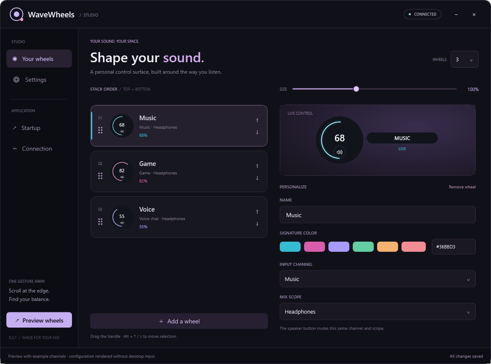
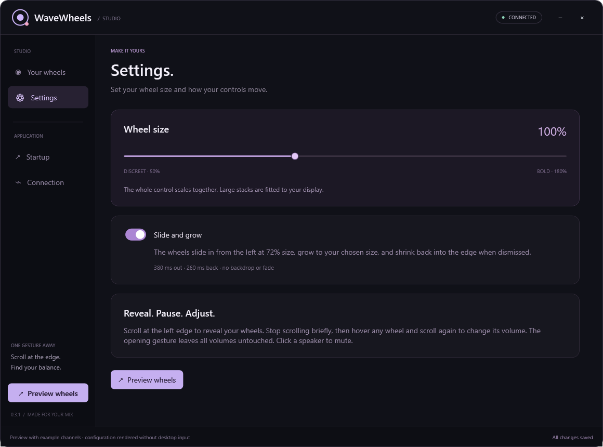

# WaveWheels

An osu!-inspired control surface for **Elgato Wave Link**, one scroll away from the left edge of your screen.

[Download the Windows release](https://github.com/notjacobwashere/WaveWheels/releases/latest) · [Report an issue](https://github.com/notjacobwashere/WaveWheels/issues)



## What it does

- Runs quietly in the Windows system tray; configuration opens when you choose it.
- Reveals transparent volume wheels with a smooth slide-and-grow animation.
- Keeps the opening scroll gesture from changing volume. Pause briefly, then scroll over a wheel to adjust it.
- Controls Wave Link input channels live, with independent whole-channel or per-mix volume and mute targets.
- Supports 1–12 wheels with custom names, colors, order, and channel bindings.
- Provides drag reordering, keyboard ordering, 50–180% wheel sizing, and an animation toggle.
- Offers optional startup at sign-in, manageable in Task Manager → Startup apps.
- Retains bindings while disconnected and reconnects automatically.

## Download and run

1. Download `WaveWheels-0.3.1-windows-x64.zip` from [Releases](https://github.com/notjacobwashere/WaveWheels/releases/latest) and extract it.
2. Install the **x64 .NET 9 Windows Desktop Runtime** if it is missing. See [Microsoft's .NET 9 downloads](https://dotnet.microsoft.com/en-us/download/dotnet/9.0). Choose **Desktop Runtime**, rather than only the base .NET runtime.
3. Keep the entire `App` folder together and run `App/WaveWheels.exe`.
4. Click the WaveWheels tray icon near the Windows clock to open configuration. Check the tray overflow if it is hidden.
5. Bind each wheel to an input channel and its desired mix scope.

Requires Windows 10/11 x64, a running Wave Link installation with its local control service available, and the .NET 9 Windows Desktop Runtime. This portable build does not bundle the runtime or an installer.

The configuration window stays closed on normal launch and at Windows sign-in. Closing configuration leaves the tray app running. Use **Quit WaveWheels** in the tray menu to exit.

## Use your wheels

Scroll at a monitor's left edge to reveal the overlay. The entire opening scroll burst leaves volume unchanged. Stop scrolling for at least **250 ms**, then hover any wheel and scroll again to change its volume. You can also drag the wheel up/down. Click its speaker button to mute or unmute the same channel/mix target; mute retains its level.

Open **Settings** to choose wheel size or disable slide-and-grow motion. Larger stacks fit the available display height. Drag the grip in the wheel list and drop on the highlighted insertion line, use the row arrows, or press **Alt+Up/Down** to reorder.



Settings save automatically in `%LOCALAPPDATA%\WaveWheels\settings.json`. They are separate from the app folder. No personal settings are bundled in downloads.

## Startup and upgrades

Enable **Start at Windows sign-in** on the **Startup** page to register the per-user Windows Run entry. Startup is off until enabled. Windows starts the app at user sign-in, not before login. Task Manager can enable or disable the entry.

Quit the old tray instance before replacing application files. Existing settings are reused. If you move the application folder, turn startup off and back on from the new location to update its path. Disable startup before permanently removing the app.

## Wave Link compatibility

WaveWheels discovers the local service port from Wave Link's `ws-info.json` and checks newer and legacy fallback ports. The **Connection** page provides a manual local port override. Connections are limited to `127.0.0.1`; no account or Stream Deck is required.

Wave Link 3 provides overall channel and per-mix targets. Legacy protocol connections provide Monitor and Stream targets. The app controls **input channels**, not Windows system volume or hardware headphone output volume. Channel and mix identifiers are saved, so recreating a channel may require rebinding it.

This is an independent project using an unofficial local protocol. Read-only discovery has been checked with Wave Link 3, and automated simulator tests cover both protocol variants. A topmost overlay may not appear over exclusive-fullscreen applications or Windows secure surfaces. See [validation details](docs/VALIDATION.md) for the limits of testing.

## Build and test

On Windows, install the .NET 9 SDK and Node.js 22 or newer, then run:

```powershell
./Build.ps1
./Test.ps1
```

The app has no third-party NuGet dependencies. Tests use isolated profiles and fake local mixer servers; they do not alter the real mixer or register startup. Compiled application files are written to `App/`, and test output goes to `artifacts/`.

Create the portable release archive with:

```powershell
./Package.ps1
```

For manual testing with a separate settings profile:

```powershell
./App/WaveWheels.exe --settings --data-dir "C:\path\to\test-profile"
```

`--settings` opens configuration explicitly. Startup registration is disabled for isolated profiles. GitHub Actions builds and tests on Windows for pushes and pull requests.

## Credits

Wheel interaction and appearance are inspired by osu!. The drawing code and procedural artwork are original; no osu! code, fonts, logos, or sounds are bundled. Windows supplies the UI fonts and speaker icons.

Protocol references: [Wave Link 3 implementation notes](https://github.com/Agash/WaveLink.Client/blob/main/PROTOCOL.md) and [legacy implementation reference](https://github.com/Professor-Melvin/ElgatoWaveLinkSDK/blob/main/WaveLinkClient.js). WaveWheels is not affiliated with or endorsed by Elgato or osu!.

## License

Copyright 2026 notjacobwashere. Licensed under the [Apache License, Version 2.0](LICENSE). See [NOTICE](NOTICE).
